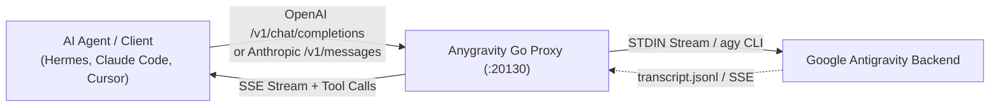

<p align="center">
  <a href="README.md"><b>🇺🇸 English</b></a> •
  <a href="README.pt-BR.md"><b>🇧🇷 Português (Brasil)</b></a>
</p>

# Anygravity

[](https://go.dev/)
[](LICENSE)

A lightweight, high-performance bridge written in pure Go (zero external dependencies, zero CGO) that exposes the Google Antigravity CLI (`agy`) as an OpenAI-compatible and Anthropic-compatible API. It allows any coding agent or LLM client (Hermes, Claude Code, Cursor, OpenCode, Aider, etc.) to use your Google Antigravity subscription for inference, tool calling, and multi-agent workflows.

---

## Features

- **Dual Protocol Support:** Compatible with both **OpenAI Chat Completions** (`/v1/chat/completions`) and **Anthropic Messages API** (`/v1/messages`, `/messages`) with full Server-Sent Events (SSE) streaming.
- **Tool Calling & Parser:** Automatic extraction of `<tool_call>` blocks and native function calls into standard client-facing tool schemas.
- **Dynamic Model Discovery:** Automatically queries your local `agy models` catalog and exposes available models via `GET /v1/models`.
- **Effort Mapping:** Standard OpenAI `reasoning_effort` (`low`, `medium`, `high`, `xhigh`) dynamically maps to corresponding Antigravity effort variants.
- **Quota & Usage Monitoring:** Real-time quota monitoring via `GET /v1/usage` for 5-hour and weekly rate limits across model families.
- **Session State & Delta Sync:** Maintains 1:1 conversation continuity in Antigravity Brain by transmitting turn deltas instead of resending full histories.
- **Process Isolation:** Runs `agy` instances in dedicated process groups (`setpgid`) with clean process tree cleanup on cancellation or timeout.
- **Ultra-low Footprint:** Consumes ~3 MB RAM, single static binary, pure standard library.

---

## Architecture



---

## Quick Start

### Build from source

Requires Go 1.22+:

```bash
git clone https://github.com/jocost4/anygravity.git
cd anygravity
go build -o anygravity main.go
./anygravity
```

The proxy starts on `http://127.0.0.1:20130`.

### Run as a systemd service (User Mode)

```bash
./install.sh --user

# Manage service
systemctl --user status anygravity
journalctl --user -u anygravity -f
systemctl --user restart anygravity
```

### Network Binding (LAN & Tailscale)

By default, Anygravity binds only to `127.0.0.1:20130`. You can bind to additional local network or Tailscale addresses using `HOST` / `BIND_ADDR` or `-host` / `-bind` (comma-separated or repeated):

```bash
# Bind to localhost + Tailscale IP(s) (auto-detected)
./anygravity -host 127.0.0.1,tailscale

# Bind to localhost + LAN private IPv4(s) (auto-detected)
./anygravity -host 127.0.0.1,lan

# Bind to specific IPs, interface names, or Tailscale MagicDNS hostname
./anygravity -host 127.0.0.1,192.168.1.50,mybox.tail1234.ts.net
./anygravity -host 127.0.0.1,tailscale0

# Or via environment variables (also supported by ./install.sh)
HOST="127.0.0.1,tailscale" ANYGRAVITY_API_KEY="your-secret" ./install.sh --user
```

> **Security note:** Always set `ANYGRAVITY_API_KEY` when binding to non-loopback addresses (`lan`, `tailscale`, `0.0.0.0`, or specific LAN/Tailscale IPs).

---

## Configuration

### Hermes Agent

Add Anygravity as a custom provider in `~/.hermes/config.yaml`:

```yaml
custom_providers:
  - name: Anygravity (localhost:20130)
    base_url: http://localhost:20130/v1
    api_key: anygravity-local
```

*(Models are discovered automatically via `GET /v1/models`)*.

To set a default model:
```bash
hermes config set model.default gemini-3.8-flash
```

### Claude Code & Anthropic Clients

Point the Anthropic base URL to Anygravity:

```bash
export ANTHROPIC_BASE_URL="http://localhost:20130"
export ANTHROPIC_API_KEY="anygravity-local"
claude
```

### OpenAI Clients / SDK

```bash
export OPENAI_BASE_URL="http://localhost:20130/v1"
export OPENAI_API_KEY="anygravity-local"
```

---

## Supported Models

Anygravity dynamically maps requests to the available models in your local `agy` installation:

| Model ID | Backend Name | Reasoning Effort | Best For |
| :--- | :--- | :--- | :--- |
| `gemini-4-argon` | Gemini 4 Argon | `low`, `medium`, `high` | Frontier reasoning, complex architecture & debugging |
| `gemini-4-hydrogen` | Gemini 4 Hydrogen | `low`, `medium`, `high`, `xhigh` | Fast agentic loops, daily coding & rapid edits |
| `gemini-pro-orchestrator-g1-pro` | Orchestrator (Argon) | Native routing | Multi-agent coordination & task decomposition |
| `gemini-3.8-flash` | Gemini 3.8 Flash | `low`, `medium`, `high` | Everyday high-speed tasks, terminal commands & scripts |
| `claude-opus-5-5` | Claude Opus 5.5 | `low`, `medium`, `high` | Deep analytical writing & system design |
| `claude-sonnet-5-5` | Claude Sonnet 5.5 | `low`, `medium`, `high` | Fast programming & multi-turn coding |
| `gpt-oss-120b` | GPT-OSS 120B | `medium` | Open weights reasoning |

---

## HTTP API Reference

| Method | Endpoint | Description |
| :--- | :--- | :--- |
| `GET` | `/health` | Health check, uptime, goroutine count, and memory stats |
| `GET` | `/metrics` | Prometheus metrics (request count, latency, memory) |
| `GET` | `/v1/models` | List available models (OpenAI format) |
| `GET` | `/v1/models/{id}` | Specific model details |
| `GET` | `/v1/usage` | Antigravity subscription quota (5-hour and weekly buckets) |
| `POST` | `/v1/chat/completions` | OpenAI Chat Completions (streaming and non-streaming) |
| `POST` | `/v1/messages` | Anthropic Messages API (streaming and non-streaming) |
| `POST` | `/messages` | Anthropic Messages API alias |
| `GET` | `/api/tags` | Ollama model tags compatibility |
| `POST` | `/api/show` | Ollama model show compatibility |

---

## Integrated MCP Server

The repository includes an optional standalone MCP server exposing Antigravity subagents and skills directly to Hermes:

```yaml
# Add in ~/.hermes/config.yaml under mcp_servers:
mcp_servers:
  antigravity:
    command: python3
    args: ["/path/to/anygravity/mcp/antigravity_mcp_server.py"]
```

---

## Testing

Run the test suite:

```bash
go test -v ./...
```

---

## License

MIT License. See [LICENSE](LICENSE) for details.
