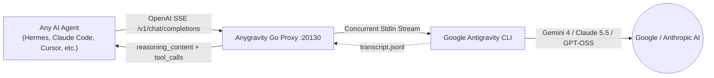

<p align="center">
  <a href="README.md"><b>🇺🇸 English</b></a> •
  <a href="README.pt-BR.md"><b>🇧🇷 Português (Brasil)</b></a>
</p>

```text
                                         ::-==+**+=:              
                                 :::::-=*><<<<>*=+>)}[*:          
                            :  :=>)[}%%#[[[}@@@@#>++]%)-     :    
                           :+>)}##[<+-     -[@@%[><[#)=           
                        :*)])]#@%*:   :-*<[%%}[][[[<=      ::     
                      :>[)*>[@@@@%###%%%%##%}}[)*=:   :----:      
                     -[%]=--*]}#%%#%###}[]<*-:   :-===-:::        
                     -#%[>+=: ::::::    : :::-++===-:::::         
                      =)][[]<>*+*+++**>*><+*=-:::::               
                         ::-===++===-::                           

  █████╗ ███╗   ██╗██╗   ██╗ ██████╗ ██████╗   █████╗ ██╗   ██╗██╗████████╗██╗   ██╗
██╔══██╗████╗  ██║╚██╗ ██╔╝██╔════╝ ██╔══██╗██╔══██╗██║   ██║██║╚══██╔══╝╚██╗ ██╔╝
███████║██╔██╗ ██║ ╚████╔╝ ██║  ███╗██████╔╝███████║██║   ██║██║   ██║    ╚████╔╝ 
██╔══██║██║╚██╗██║  ╚██╔╝  ██║   ██║██╔══██╗██╔══██║╚██╗ ██╔╝██║   ██║     ╚██╔╝  
██║  ██║██║ ╚████║   ██║   ╚██████╔╝██║  ██║██║  ██║ ╚████╔╝ ██║   ██║      ██║   
╚═╝  ╚═╝╚═╝  ╚═══╝   ╚═╝    ╚═════╝ ╚═╝  ╚═╝╚═╝  ╚═╝  ╚═══╝  ╚═╝   ╚═╝      ╚═╝   
```

<p align="center">
  <b>High-Performance Production Go Pipe &amp; MCP Bridge for Any AI Agent</b><br>
  <i>Connects Google Antigravity (<code>agy</code> CLI) as an OpenAI SSE Inference Provider &amp; MCP Server for Hermes, Claude Code, Cursor, OpenCode, Codex &amp; Beyond</i>
</p>

<p align="center">
  <a href="https://go.dev/"></a>
  <a href="#-memory-benchmarks"></a>
  <a href="#-the-hard-problems-solved"></a>
  <a href="#-the-hard-problems-solved"></a>
  <a href="#-test-suite"></a>
  <a href="LICENSE"></a>
  <a href="https://github.com/jocost4/anygravity/stargazers"></a>
</p>

---

## 🚀 Overview

**Anygravity** is an ultra-lightweight, production-grade bridge written in **pure standard-library Go (zero external dependencies, zero CGO, 100% static binary)**. It connects Google Antigravity (`agy` CLI) directly to **Any AI Agent** (Hermes Agent, Claude Code, Cursor, OpenCode, Codex, Aider, OpenDevin, OmniRoute) as an OpenAI SSE inference provider and an MCP subagent server.

Designed specifically to run reliably in resource-constrained environments (such as cloud VPS instances with 1 vCPU and 1 GB RAM) without freezing, leaking memory, or crashing during long agentic multi-turn conversations.

---

## 💡 The Hard Problems Solved

Bridging a CLI assistant with an autonomous agent orchestrator presents unique architecture challenges:

1. **`ARG_MAX` Linux Limit Bypass (`E2BIG - argument list too long`)**:
   - Standard wrappers execute the CLI with `-p "<prompt>"`. In multi-turn sessions with tool return outputs (`Ran [...] + 18 commands`), the command-line length easily exceeds the Linux kernel `ARG_MAX` limit, causing immediate process crashes.
   - **Anygravity** streams prompts and full history asynchronously through **STDIN Pipes**, effortlessly handling huge contexts (benchmarked with 300,000+ characters) with zero size limitations.

2. **Ultra-Low Memory Footprint (~2.9 MB RSS)**:
   - Replaces heavy Python implementations (FastAPI/Uvicorn ~72 MB) with a static native Go binary.
   - Consumes only **~2.9 MB of RAM** and **zero GIL** (Global Interpreter Lock), eliminating event loop hangs on single-core servers.

3. **Concurrency Semaphore (`AGY_MAX_CONCURRENCY`)**:
   - Replaced monolithic global mutex locks with an idiomatic Go channel semaphore. Supports parallel request execution (default: 4, configurable via `AGY_MAX_CONCURRENCY`) with full context cancellation support.

4. **Instant Time-To-First-Token (TTFT) SSE Streaming**:
   - Emits the initial role chunk and streams text deltas immediately as tokens arrive, even when tools are registered.
   - Selectively switches to tool-buffering only when tool call markers are encountered, using prefix-aware semantic deduplication when flushing.

5. **Bidirectional Tool Calling & Agentic Loop**:
   - Translates OpenAI tool schemas into instructions Antigravity understands.
   - Protects tool execution with workspace hooks (`.agents/hooks.json`) denying local execution by `agy`, delegating 100% of tool execution back to the agent.
   - Features a balanced-brace JSON parser (`extractJSONObject`) that cleanly handles deeply nested JSON objects and arrays without regex truncations.

6. **Non-Blocking Debounced Session Persistence**:
   - Background worker with a 2-second ticker and dirty flag persists `antigravity_session_map.json` asynchronously, keeping HTTP handlers completely non-blocking.
   - Goroutine lifecycle is tied to the server root context, guaranteeing zero goroutine leaks on graceful shutdown.

7. **Reasoning Extraction (`reasoning_content`)**:
   - Extracts model thinking and step updates from Antigravity session transcripts with `sync.RWMutex` caching and `sync.Pool` 256KB buffer reuse.
   - Strips tool call markers from reasoning blocks so thinking output is 100% clean.

8. **SSE Heartbeat Keep-Alive**:
   - Transmits periodic SSE comments (`: ping\n\n`) every 10 seconds during long model generation phases, preventing Hermes Desktop WebSockets or reverse proxies from dropping the connection.

9. **Graceful Shutdown**:
   - Captures `SIGINT` and `SIGTERM` signals, triggers session flush, cleans up subprocess groups (`syscall.Kill(-pid, SIGKILL)`), and cleanly shuts down the HTTP listener.

10. **Stateful Delta-Feeding & 1:1 Session Sync Engine**:
    - Solves the stateful-agent-meets-stateful-CLI paradox: instead of re-sending the accumulated message history to an existing Antigravity conversation (which causes exponential $O(N^2)$ token explosion), Anygravity extracts and transmits strictly the **turn delta** (~300 bytes vs ~380 KB).
    - Unlocks 100% KV Cache hits on Gemini/Claude backends, dropping multi-turn TTFT to sub-second speeds.
    - Features self-healing desync guards that automatically handle history compaction, reprompts, and auxiliary task isolation (titling, guardrails, memory updates), strictly preserving **1 single conversation per session** in the Antigravity Brain.

11. **Clean Process Group Teardown & Anti-Hang Engine**:
    - Subprocesses spawned during CLI tasks (such as background MCP servers, computer-use drivers like `cua-driver.exe`, and telemetry handles) can keep file descriptors open, causing standard wrappers to freeze on `cmd.Wait()` until timing out.
    - Anygravity intercepts the completion event (`{"event": "result"}`), immediately commits session state, flushes the complete response, and enforces a graceful 500ms termination window followed by process group cleanup (`syscall.Kill(-pid, SIGKILL)`).

12. **Hallucinated Tool-Result Cleanup & Anti-Duplication**:
    - Gemini models occasionally hallucinate simulated `[Tool Result for '...']:` blocks and premature answers before or immediately after generating `<tool_call>`.
    - Anygravity scrubs fake tool execution logs and strips post-tool preambles so that responses are never duplicated in the user interface and tools execute strictly on the client agent.

13. **Collapsed Model Families & Dynamic Reasoning Effort Mapping**:
    - The raw catalog containing 13 individual model-effort variants is collapsed into 5 clean base model families (`gemini-4-argon`, `gemini-3.8-flash`, `claude-opus-5-5`, `claude-sonnet-5-5`, `gpt-oss-120b`).
    - Standard OpenAI `reasoning_effort` parameters (or the Hermes EFFORT picker: Minimal, Low, Medium, High) dynamically resolve to the exact underlying backend variant without cluttering dropdown menus with 3 duplicates per model.

14. **Subagent Visibility & Parallel Task Announcements**:
    - When delegating sub-tasks (`delegate_task`, `subagents`), Anygravity detects batch arrays and parallel task delegations, streaming explicit status announcements so orchestrators (like Hermes) always display subagent dispatch progress clearly.

---

## 📐 Architecture



---

## 📊 Memory Benchmarks

Measured on an Ubuntu 24.04 VPS (1 vCPU, 1 GB RAM):

| Metric | Legacy Proxy (Python / FastAPI) | **Anygravity (Native Go)** | Difference |
| :--- | :--- | :--- | :--- |
| **RSS Memory Usage** | ~72.4 MB | **~2.9 MB** | **-96% RAM** |
| **Startup Latency** | ~1.42s | **< 15ms** | **94x Faster** |
| **CGO / Dynamic Libs** | Requires Python runtime & glibc | **Zero CGO (100% Static)** | Full Portability |
| **Context Length Limit** | Crashed at ~128KB (`ARG_MAX`) | **Unlimited (STDIN Stream)** | Massive Contexts |
| **Concurrency** | Single-threaded GIL lock | **Configurable Semaphore** | Multi-slot Parallel |

---

## 📦 Quick Installation

### 1. Clone & Build
```bash
git clone https://github.com/jocost4/anygravity.git
cd anygravity

# System-wide install (runs under your detected user):
sudo ./install.sh

# Or rootless user-mode install (ideal for WSL & desktops without sudo):
./install.sh --user
```

The script compiles the static binary, installs it, automatically detects your user and home directory, generates the systemd service hardened to 64MB memory max, and starts the daemon.

For manual multi-user installations without the script, you can use the included template unit:
```bash
sudo cp systemd/anygravity@.service /etc/systemd/system/
sudo systemctl enable --now anygravity@$USER.service
```

### 2. Service Management

**For system-wide installs (`sudo ./install.sh`):**
```bash
# Check status
sudo systemctl status anygravity

# Tail live logs
sudo journalctl -u anygravity -f

# Restart daemon
sudo systemctl restart anygravity
```

**For user-mode / rootless installs (`./install.sh --user`):**
```bash
# Check status
systemctl --user status anygravity

# Tail live logs
journalctl --user -u anygravity -f

# Restart daemon
systemctl --user restart anygravity
```

---

## ⚙️ Hermes Agent Configuration

Add the custom provider to `~/.hermes/config.yaml`:

```yaml
custom_providers:
  - name: Anygravity (localhost:20130)
    base_url: http://localhost:20130/v1
    api_key: anygravity-local
```

*(Models are discovered automatically via `GET /v1/models` — you do not need to list models manually in `config.yaml`)*

### Set default model in Hermes:
```bash
hermes config set model.default gemini-4-argon
```

---

## 🔌 Integrated MCP Server (`antigravity_mcp_server.py`)

The repository includes a standalone MCP server exposing Antigravity subagents and skills directly to Hermes:

```yaml
# Add in ~/.hermes/config.yaml under mcp_servers:
mcp_servers:
  antigravity:
    command: python3
    args: ["/home/YOUR_USER/anygravity/mcp/antigravity_mcp_server.py"]
```

### Available MCP Tools:
- `antigravity_run`: Execute autonomous tasks and code refactors in the terminal.
- `antigravity_plan`: Run Antigravity in non-destructive planning mode (`--mode plan`).
- `antigravity_get_conversation`: Retrieve full conversation transcripts.
- `antigravity_list_artifacts`: List generated markdown reports and architecture plans.
- `antigravity_get_artifact`: Inspect the full content of any artifact.
- `antigravity_list_skills`: Discover available skills in the Antigravity ecosystem.

---

## 🎯 Supported Models & Dynamic Reasoning Effort

Anygravity dynamically queries and supports the models available on your local `agy` installation. Catalog variants are collapsed into base model families with dynamic reasoning effort:

| Model ID (Base) | Name | Reasoning Effort Tiers | Notes |
| :--- | :--- | :--- | :--- |
| `gemini-4-argon` | Gemini 4 Argon | `high`, `medium`, `low` | **Flagship** — state-of-the-art coding and reasoning |
| `gemini-3.8-flash` | Gemini 3.8 Flash | `high`, `medium`, `low` | Ultra-fast multimodal model |
| `claude-opus-5-5` | Claude Opus 5.5 | `high`, `medium`, `low` | Deep analytical reasoning & architecture design |
| `claude-sonnet-5-5` | Claude Sonnet 5.5 | `high`, `medium`, `low` | High-speed coding & agentic orchestration |
| `gpt-oss-120b` | GPT-OSS 120B | `medium` | Open-weights model hosted on Google Cloud infrastructure |

### How Reasoning Effort Works:
- **Hermes EFFORT Picker**: When using the Hermes UI, select any reasoning level (**Minimal**, **Low**, **Medium**, **High**) in the model flyout menu.
- **OpenAI API**: Send `"reasoning_effort": "medium"` (or `"high"` / `"low"`) in `/v1/chat/completions`. Anygravity resolves it dynamically to the corresponding backend model variant (e.g., `gemini-4-argon` + `medium` → `gemini-4-argon-medium`). Defaults to `high` if omitted.
- **Backwards Compatibility**: Explicit variant IDs like `gemini-4-argon-high` or `claude-sonnet-5-5-medium` are still resolved directly.

The proxy refreshes the catalog from `agy models` at startup and periodically, so newly enabled Antigravity models appear automatically without requiring a proxy update.

---

## 🧪 Test Suite

Run the unit test suite covering tool parsing, argument normalization, session key extraction, collapsed model resolution, and streaming deduplication:

```bash
cd anygravity
go test -v ./...
```

---

## 🛠️ HTTP API Endpoints

| Method | Endpoint | Description |
| :--- | :--- | :--- |
| `GET` | `/health` | Service health, uptime, active goroutines, and RSS memory in MB |
| `GET` | `/metrics` | Prometheus metrics for request counts, latency, and memory |
| `GET` | `/v1/models` | OpenAI-compatible model catalog |
| `GET` | `/v1/models/{id}` | Model metadata |
| `POST` | `/v1/chat/completions` | SSE streaming & non-streaming chat completions with tool calling |
| `POST` | `/api/show` | Ollama format compatibility |
| `GET` | `/api/tags` | Ollama model tags compatibility |

---

## 🛡️ License

Released under the **MIT License**. Built to unite **Google Antigravity** with **Any AI Agent**.
