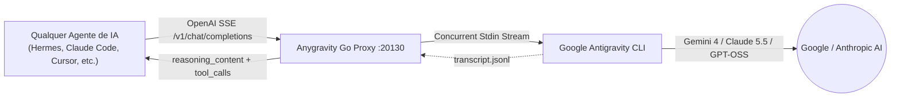

<p align="center">
  <a href="README.md"><b>🇺🇸 English</b></a> •
  <a href="README.pt-BR.md"><b>🇧🇷 Português (Brasil)</b></a>
</p>

```text
                                         ::-==+**+=:              
                                 :::::-=*><<<<>*=+>)}[*:          
                            :  :=>)[}%%#[[[}@@@@#>++]%)-     :    
                           :+>)}##[<+-     -[@@%[><[#)=           
                        :*)])]#@%*:   :-*<[%%}[][[[<=      ::     
                      :>[)*>[@@@@%###%%%%##%}}[)*=:   :----:      
                     -[%]=--*]}#%%#%###}[]<*-:   :-===-:::        
                     -#%[>+=: ::::::    : :::-++===-:::::         
                      =)][[]<>*+*+++**>*><+*=-:::::               
                         ::-===++===-::                           

  █████╗ ███╗   ██╗██╗   ██╗ ██████╗ ██████╗   █████╗ ██╗   ██╗██╗████████╗██╗   ██╗
██╔══██╗████╗  ██║╚██╗ ██╔╝██╔════╝ ██╔══██╗██╔══██╗██║   ██║██║╚══██╔══╝╚██╗ ██╔╝
███████║██╔██╗ ██║ ╚████╔╝ ██║  ███╗██████╔╝███████║██║   ██║██║   ██║    ╚████╔╝ 
██╔══██║██║╚██╗██║  ╚██╔╝  ██║   ██║██╔══██╗██╔══██║╚██╗ ██╔╝██║   ██║     ╚██╔╝  
██║  ██║██║ ╚████║   ██║   ╚██████╔╝██║  ██║██║  ██║ ╚████╔╝ ██║   ██║      ██║   
╚═╝  ╚═╝╚═╝  ╚═══╝   ╚═╝    ╚═════╝ ╚═╝  ╚═╝╚═╝  ╚═╝  ╚═══╝  ╚═╝   ╚═╝      ╚═╝   
```

<p align="center">
  <b>Pipe Go de Alta Performance &amp; Ponte MCP para Qualquer Agente de IA</b><br>
  <i>Conecta o Google Antigravity (CLI <code>agy</code>) diretamente como Provider OpenAI SSE &amp; Servidor MCP para Hermes, Claude Code, Cursor, OpenCode, Codex e além</i>
</p>

<p align="center">
  <a href="https://go.dev/"></a>
  <a href="#-benchmarks-de-memória"></a>
  <a href="#-problemas-críticos-resolvidos"></a>
  <a href="#-problemas-críticos-resolvidos"></a>
  <a href="#-suite-de-testes"></a>
  <a href="LICENSE"></a>
  <a href="https://github.com/jocost4/anygravity/stargazers"></a>
</p>

---

## 🚀 O que é o Anygravity?

O **Anygravity** é um proxy/pipe de altíssima performance e nível de produção, escrito em **Go puro (sem dependências externas, sem CGO e com binário 100% estático)**, projetado para transformar o Google Antigravity (`agy` CLI) em um provedor de inferência OpenAI SSE e um servidor MCP universal para **qualquer agente de IA** (Hermes Agent, Claude Code, Cursor, OpenCode, Codex, Aider, OpenDevin, OmniRoute, etc.).

Criado para operar com estabilidade absoluta em ambientes com poucos recursos (como VPS de 1 vCPU e 1 GB de RAM), garantindo zero congelamentos, zero vazamento de memória e suporte a conversas multi-turn complexas com chamada de ferramentas.

---

## 💡 Problemas Críticos Resolvidos

1. **Bypass de `ARG_MAX` (`E2BIG - argument list too long`)**:
   - Proxies comuns disparam o executável com `-p "<prompt>"`. Após algumas rodadas de conversa com retornos de ferramentas (`Ran [...] + 18 commands`), o tamanho dos argumentos excede o limite do kernel Linux (`ARG_MAX`), travando a execução.
   - O **Anygravity** transmite todo o histórico e instruções via **STDIN Pipe assíncrono**, suportando prompts gigantescos (testado com mais de 300.000 caracteres) sem limite de tamanho.

2. **Pegada de Memória Ridiculamente Baixa (~2.9 MB RSS)**:
   - Substitui implementações pesadas em Python (FastAPI/Uvicorn ~72 MB) por um binário nativo Go estático.
   - Consome apenas **~2.9 MB de RAM** e **zero GIL** (Global Interpreter Lock), eliminando travamentos de event loop em processadores de núcleo único.

3. **Semáforo de Concorrência (`AGY_MAX_CONCURRENCY`)**:
   - Substituiu locks globais monolíticos por um semáforo idiomático de canal Go. Suporta até 4 requisições simultâneas por padrão (configurável via `AGY_MAX_CONCURRENCY`) com suporte a cancelamento limpo por contexto HTTP.

4. **Streaming SSE com TTFT Instantâneo**:
   - Emite o chunk inicial de `role: assistant` e transmite deltas de texto em tempo real assim que os tokens chegam, mesmo quando ferramentas estão ativas.
   - Ativa bufferização seletiva apenas quando marcadores de ferramentas são encontrados, utilizando deduplicação semântica por prefixo no flush.

5. **Tool Calling Bidirecional e Ciclo de Agentificação**:
   - Mapeia schemas de ferramentas do formato OpenAI (`tools`) para instruções interpretáveis pelo Antigravity.
   - Protege a execução local via workspace hooks (`.agents/hooks.json`) que negam a execução local no `agy`, delegando 100% da execução das ferramentas de volta ao agente chamador.
   - Inclui parser de chaves balanceadas (`extractJSONObject`) imune a quebras de regex em objetos e arrays JSON aninhados.

6. **Persistência de Sessões Assíncrona e Debounced**:
   - Worker em segundo plano com ticker de 2 segundos e dirty flag salva o `antigravity_session_map.json` de forma assíncrona, mantendo os handlers HTTP totalmente não-bloqueantes.
   - Ciclo de vida da goroutine atrelado ao `rootCtx` do servidor, garantindo zero vazamento de goroutines no shutdown.

7. **Extração Nativa de Raciocínio (`reasoning_content`)**:
   - Captura pensamentos internos e passos dos transcripts do Antigravity com cache thread-safe (`sync.RWMutex`) e reaproveitamento de buffers de 256KB (`sync.Pool`).
   - Remove marcadores de tool calls dos blocos de pensamento, garantindo que o `reasoning_content` entregue apenas a linha de raciocínio limpa.

8. **SSE Heartbeat Keep-Alive**:
   - Envia comentários SSE periódicos (`: ping\n\n`) a cada 10 segundos de silêncio do modelo, impedindo que o WebSocket do Hermes Desktop ou gateways encerrem a conexão por timeout.

9. **Graceful Shutdown**:
   - Captura sinais `SIGINT` e `SIGTERM`, faz o flush atômico do mapa de sessões, encerra grupos de subprocessos (`syscall.Kill(-pid, SIGKILL)`) e desliga o servidor HTTP de forma limpa.

10. **Stateful Delta-Feeding & Sincronização 1:1 de Sessões**:
    - Resolve o paradoxo entre o agente cumulativo (Hermes) e a CLI persistente (Antigravity): em vez de re-enviar todo o histórico acumulado (o que causava explosão exponencial $O(N^2)$ de tokens), o Anygravity extrai e transmite estritamente o **delta do turno** (~300 bytes contra ~380 KB).
    - Habilita 100% de reaproveitamento de KV Cache nos backends Gemini/Claude, despencando o TTFT multi-turno para centenas de milissegundos.
    - Possui salvaguardas de auto-cura contra desync que tratam podas/compactações de contexto, reprompts e isolamento de tarefas efêmeras (títulos, guardrails, reflexão de memória), mantendo **estritamente 1 única conversa por sessão** no Brain do Antigravity.

11. **Finalização Limpa de Subprocessos & Anti-Congelamento**:
    - Subprocessos em background gerados durante as tarefas da CLI (como servidores MCP em segundo plano, drivers de computer-use como `cua-driver.exe` e telemetria) mantinham descritores abertos, fazendo wrappers padrão travarem no `cmd.Wait()` até o timeout de 600s.
    - O Anygravity intercepta o evento de conclusão (`{"event": "result"}`), persiste o estado da sessão imediatamente, faz o flush da resposta completa e aplica uma janela de tolerância de 500ms seguida do encerramento seguro do grupo de processos (`syscall.Kill(-pid, SIGKILL)`).

12. **Higienização de Tool-Results Alucinados & Anti-Duplicação**:
    - Modelos Gemini ocasionalmente alucinam blocos simulados de `[Tool Result for '...']:` e respostas antecipadas antes ou imediatamente após gerarem `<tool_call>`.
    - O Anygravity remove esses logs de ferramentas alucinadas e descarta preâmbulos pós-ferramenta, garantindo que as respostas nunca saiam duplicadas na interface e que as ferramentas sejam executadas estritamente pelo agente cliente.

13. **Modelos Base Enxutos & Mapeamento Dinâmico de Reasoning Effort**:
    - O catálogo bruto com 13 variantes individuais de modelo/esforço é agrupado em 5 famílias limpas de modelos base (`gemini-4-argon`, `gemini-3.8-flash`, `claude-opus-5-5`, `claude-sonnet-5-5`, `gpt-oss-120b`).
    - Parâmetros padrão da OpenAI como `reasoning_effort` (ou o seletor de EFFORT do Hermes: Minimal, Low, Medium, High) resolvem dinamicamente para a variante exata do catálogo sem poluir os menus com 3 cópias do mesmo modelo.

14. **Visibilidade de Subagentes & Anúncios de Delegação Paralela**:
    - Ao delegar subtarefas (`delegate_task`, `subagents`), o Anygravity detecta arrays em lote e delegações paralelas, emitindo anúncios de status explícitos para que o orquestrador (como o Hermes) acompanhe visualmente o progresso dos subagentes em segundo plano.

---

## 📐 Arquitetura



---

## 📊 Benchmarks de Memória

Testado em VPS Ubuntu 24.04 (1 vCPU, 1 GB RAM):

| Métrica | Proxy Legado (Python / FastAPI) | **Anygravity (Go Nativo)** | Diferença |
| :--- | :--- | :--- | :--- |
| **Uso de Memória RSS** | ~72.4 MB | **~2.9 MB** | **-96% de RAM** |
| **Tempo de Inicialização** | ~1.42s | **< 15ms** | **94x mais rápido** |
| **CGO / Dependências C** | Exige Python & glibc | **Zero CGO (100% Estático)** | Portabilidade total |
| **Limite de Contexto** | Quebrava em ~128KB (`ARG_MAX`) | **Ilimitado (Streaming STDIN)** | Suporta contextos gigantes |
| **Concorrência** | Monothread bloqueante | **Semáforo Multi-Slot** | Paralelismo real |

---

## 📦 Instalação Rápida

### 1. Clonar e Compilar
```bash
git clone https://github.com/jocost4/anygravity.git
cd anygravity

# Instalação para o sistema todo (configura para o seu usuário detectado):
sudo ./install.sh

# Ou instalação em modo de usuário sem root (ideal para WSL e desktops):
./install.sh --user
```

O instalador compila o binário estático, instala no PATH, detecta automaticamente o seu usuário e diretório home reais, cria o serviço systemd configurado com limite de 64MB de RAM e inicia o daemon.

Para instalações manuais multiusuário sem o script, você também pode usar a unidade de template inclusa:
```bash
sudo cp systemd/anygravity@.service /etc/systemd/system/
sudo systemctl enable --now anygravity@$USER.service
```

### 2. Comandos do Serviço Systemd

**Para instalação no sistema todo (`sudo ./install.sh`):**
```bash
# Ver status em tempo real
sudo systemctl status anygravity

# Acompanhar logs
sudo journalctl -u anygravity -f

# Reiniciar serviço
sudo systemctl restart anygravity
```

**Para instalação em modo de usuário sem root (`./install.sh --user`):**
```bash
# Ver status em tempo real
systemctl --user status anygravity

# Acompanhar logs
journalctl --user -u anygravity -f

# Reiniciar serviço
systemctl --user restart anygravity
```

---

## ⚙️ Configuração no Hermes Agent

Edite seu arquivo `~/.hermes/config.yaml`:

```yaml
custom_providers:
  - name: Anygravity (localhost:20130)
    base_url: http://localhost:20130/v1
    api_key: anygravity-local
```

*(Os modelos são descobertos automaticamente via `GET /v1/models` — você não precisa listá-los manualmente no YAML)*

### Definir modelo padrão no Hermes:
```bash
hermes config set model.default gemini-4-argon
```

---

## 🔌 Servidor MCP Integrado (`antigravity_mcp_server.py`)

O repositório inclui um servidor MCP nativo para expor as capacidades completas do Antigravity como ferramentas para o Hermes Agent:

```yaml
# Adicione em ~/.hermes/config.yaml sob mcp_servers:
mcp_servers:
  antigravity:
    command: python3
    args: ["/home/seu-usuario/anygravity/mcp/antigravity_mcp_server.py"]
```

### Ferramentas MCP Disponíveis:
- `antigravity_run`: Executa refatores e tarefas autônomas no terminal com aprovação automática.
- `antigravity_plan`: Executa o Antigravity em modo de planejamento (`--mode plan`).
- `antigravity_get_conversation`: Resgata histórico de conversas do Antigravity.
- `antigravity_list_artifacts`: Lista planos e relatórios `.md` gerados pelo Antigravity.
- `antigravity_get_artifact`: Lê o conteúdo completo de um artefato específico.
- `antigravity_list_skills`: Descobre skills instaladas no ecossistema Antigravity.

---

## 🎯 Modelos Suportados & Reasoning Effort Dinâmico

O Anygravity consulta e suporta dinamicamente os modelos da sua instalação local do `agy`. As variantes são agrupadas em famílias de modelos base limpas:

| ID do Modelo (Base) | Nome | Níveis de Esforço Suportados | Observações |
| :--- | :--- | :--- | :--- |
| `gemini-4-argon` | Gemini 4 Argon | `high`, `medium`, `low` | **Flagship** — ponta de linha do Google com raciocínio e coding avançados |
| `gemini-3.8-flash` | Gemini 3.8 Flash | `high`, `medium`, `low` | Modelo multimodal ultra-rápido |
| `claude-opus-5-5` | Claude Opus 5.5 | `high`, `medium`, `low` | Raciocínio analítico profundo e design de arquitetura |
| `claude-sonnet-5-5` | Claude Sonnet 5.5 | `high`, `medium`, `low` | Orquestração agentic e programação de alta velocidade |
| `gpt-oss-120b` | GPT-OSS 120B | `medium` | Modelo open-weights hospedado no Google Cloud |

### Como Funciona o Reasoning Effort:
- **Seletor de EFFORT no Hermes**: Na interface do Hermes, basta selecionar o nível desejado (**Minimal**, **Low**, **Medium**, **High**) no menu do modelo.
- **API OpenAI Padrão**: Envie `"reasoning_effort": "medium"` (ou `"high"` / `"low"`) na requisição. O Anygravity mapeia dinamicamente para a variante exata do backend (ex.: `gemini-4-argon` + `medium` → `gemini-4-argon-medium`). O padrão é `high` quando omitido.
- **Retrocompatibilidade**: IDs explícitos como `gemini-4-argon-high` ou `claude-sonnet-5-5-medium` continuam funcionando diretamente se forem solicitados.

O proxy atualiza o catálogo via `agy models` na inicialização e periodicamente em segundo plano, para que novos modelos disponibilizados pelo Google apareçam automaticamente sem necessidade de update do código.

---

## 🧪 Suite de Testes

Execute a suite de testes unitários que cobre parsing de ferramentas, normalização de argumentos, hash de sessão, resolução de modelos agrupados e deduplicação de streaming:

```bash
cd anygravity
go test -v ./...
```

---

## 🛠️ Endpoints Disponíveis

| Método | Endpoint | Descrição |
| :--- | :--- | :--- |
| `GET` | `/health` | Status do serviço, uptime, rotinas ativas e uso de RAM em MB |
| `GET` | `/metrics` | Métricas Prometheus de requisições e memória |
| `GET` | `/v1/models` | Lista de modelos compatível com OpenAI |
| `GET` | `/v1/models/{id}` | Metadados do modelo |
| `POST` | `/v1/chat/completions` | Streaming (SSE) e Non-Streaming chat completions com tool calling |
| `POST` | `/api/show` | Compatibilidade com Ollama |
| `GET` | `/api/tags` | Compatibilidade com Ollama |

---

## 🛡️ Licença

Distribuído sob a licença MIT. Criado para a comunidade open-source unindo o ecossistema do **Google Antigravity** com **qualquer agente de IA**.
