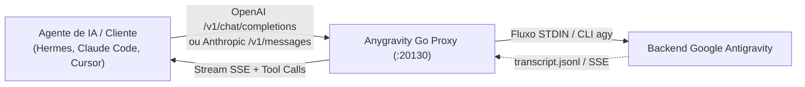

<p align="center">
  <a href="README.md"><b>🇺🇸 English</b></a> •
  <a href="README.pt-BR.md"><b>🇧🇷 Português (Brasil)</b></a>
</p>

# Anygravity

[](https://go.dev/)
[](LICENSE)

Uma ponte leve e de alta performance escrita em Go puro (zero dependências externas, zero CGO) que expõe o CLI oficial Google Antigravity (`agy`) como uma API compatível com OpenAI e Anthropic. Permite que qualquer agente de código ou cliente LLM (Hermes, Claude Code, Cursor, OpenCode, Aider, etc.) utilize sua assinatura do Google Antigravity para inferência, chamadas de ferramentas (*tool calling*) e fluxos multiagente.

---

## Recursos

- **Suporte Dual-Protocol:** Compatível com **OpenAI Chat Completions** (`/v1/chat/completions`) e **Anthropic Messages API** (`/v1/messages`, `/messages`) com streaming Server-Sent Events (SSE) completo.
- **Parser de Tool Calling:** Extração automática de blocos `<tool_call>` e chamadas de função nativas convertidas para os esquemas de ferramentas esperados pelos clientes.
- **Descoberta Dinâmica de Modelos:** Consulta automaticamente o catálogo do `agy models` local e expõe os modelos disponíveis via `GET /v1/models`.
- **Mapeamento de Esforço de Raciocínio:** O parâmetro padrão `reasoning_effort` (`low`, `medium`, `high`, `xhigh`) é mapeado dinamicamente para os níveis de esforço correspondentes no Antigravity.
- **Monitoramento de Quota e Consumo:** Consulta em tempo real via `GET /v1/usage` dos limites de 5 horas e semanais de cada família de modelos.
- **Sincronização de Estado por Delta:** Mantém continuidade 1:1 com a conversa no Antigravity Brain transmitindo apenas os deltas de cada turno, evitando explosão de tokens.
- **Isolamento de Processos:** Executa instâncias do `agy` em grupos de processos dedicados (`setpgid`), garantindo encerramento limpo de processos filhos em caso de cancelamento ou timeout.
- **Baixíssimo Consumo:** Consome ~3 MB de RAM, binário estático único compilado em Go padrão.

---

## Arquitetura



---

## Início Rápido

### Compilar a partir do código-fonte

Requer Go 1.22+:

```bash
git clone https://github.com/jocost4/anygravity.git
cd anygravity
go build -o anygravity main.go
./anygravity
```

O proxy inicia em `http://127.0.0.1:20130`.

### Executar como serviço systemd (Modo Usuário)

```bash
./install.sh --user

# Gerenciar serviço
systemctl --user status anygravity
journalctl --user -u anygravity -f
systemctl --user restart anygravity
```

### Bind em Rede Local (LAN) e Tailscale

Por padrão, o Anygravity escuta apenas em `127.0.0.1:20130`. Você pode fazer bind em outros endereços da rede local ou do Tailscale via `HOST` / `BIND_ADDR` ou pelas flags `-host` / `-bind` (separados por vírgula ou repetidos):

```bash
# Bind em localhost + IP(s) do Tailscale (detecção automática)
./anygravity -host 127.0.0.1,tailscale

# Bind em localhost + IP(s) privados da LAN (detecção automática)
./anygravity -host 127.0.0.1,lan

# Bind em IPs específicos, nomes de interface ou hostname MagicDNS do Tailscale
./anygravity -host 127.0.0.1,192.168.1.50,mybox.tail1234.ts.net
./anygravity -host 127.0.0.1,tailscale0

# Ou via variáveis de ambiente (também suportado pelo ./install.sh)
HOST="127.0.0.1,tailscale" ANYGRAVITY_API_KEY="sua-chave-secreta" ./install.sh --user
```

> **Nota de segurança:** Sempre defina `ANYGRAVITY_API_KEY` ao fazer bind em endereços que não sejam loopback (`lan`, `tailscale`, `0.0.0.0` ou IPs de LAN/Tailscale).

---

## Configuração

### Hermes Agent

Adicione o Anygravity como provedor customizado em `~/.hermes/config.yaml`:

```yaml
custom_providers:
  - name: Anygravity (localhost:20130)
    base_url: http://localhost:20130/v1
    api_key: anygravity-local
```

*(Os modelos são descobertos automaticamente via `GET /v1/models`)*.

Para definir um modelo padrão no Hermes:
```bash
hermes config set model.default gemini-3.8-flash
```

### Claude Code & Clientes Anthropic

Aponte a URL base da Anthropic para o Anygravity:

```bash
export ANTHROPIC_BASE_URL="http://localhost:20130"
export ANTHROPIC_API_KEY="anygravity-local"
claude
```

### Clientes OpenAI / SDKs

```bash
export OPENAI_BASE_URL="http://localhost:20130/v1"
export OPENAI_API_KEY="anygravity-local"
```

---

## Modelos Suportados

O Anygravity mapeia requisições dinamicamente para os modelos disponíveis no seu `agy` local:

| ID do Modelo | Nome no Backend | Níveis de Esforço (*Thinking*) | Melhor Para |
| :--- | :--- | :--- | :--- |
| `gemini-4-argon` | Gemini 4 Argon | `low`, `medium`, `high` | Raciocínio de fronteira, arquiteturas complexas e debugging crítico |
| `gemini-4-hydrogen` | Gemini 4 Hydrogen | `low`, `medium`, `high`, `xhigh` | Loops de programação rápidos, subagentes e edições contínuas |
| `gemini-pro-orchestrator-g1-pro` | Orchestrator (Argon) | Roteamento nativo | Coordenação multiagente e decomposição de tarefas |
| `gemini-3.8-flash` | Gemini 3.8 Flash | `low`, `medium`, `high` | Tarefas do dia a dia, comandos de terminal e scripts rápidos |
| `claude-opus-5-5` | Claude Opus 5.5 | `low`, `medium`, `high` | Análise profunda e design de sistemas |
| `claude-sonnet-5-5` | Claude Sonnet 5.5 | `low`, `medium`, `high` | Programação ágil e contexto longo |
| `gpt-oss-120b` | GPT-OSS 120B | `medium` | Raciocínio com pesos abertos |

---

## Referência da API HTTP

| Método | Endpoint | Descrição |
| :--- | :--- | :--- |
| `GET` | `/health` | Checagem de saúde, tempo ativo, número de goroutines e uso de memória |
| `GET` | `/metrics` | Métricas Prometheus (total de requisições, latência e memória) |
| `GET` | `/v1/models` | Lista modelos disponíveis (formato OpenAI) |
| `GET` | `/v1/models/{id}` | Metadados de um modelo específico |
| `GET` | `/v1/usage` | Quota de uso da assinatura Antigravity (baldes de 5h e semanal) |
| `POST` | `/v1/chat/completions` | OpenAI Chat Completions (streaming e não-streaming) |
| `POST` | `/v1/messages` | Anthropic Messages API (streaming e não-streaming) |
| `POST` | `/messages` | Alias da API Anthropic Messages |
| `GET` | `/api/tags` | Compatibilidade de tags do Ollama |
| `POST` | `/api/show` | Compatibilidade de informações de modelo do Ollama |

---

## Servidor MCP Integrado

O repositório inclui um servidor MCP standalone opcional que expõe habilidades e subagentes do Antigravity diretamente ao Hermes:

```yaml
# Adicionar em ~/.hermes/config.yaml sob mcp_servers:
mcp_servers:
  antigravity:
    command: python3
    args: ["/caminho/para/anygravity/mcp/antigravity_mcp_server.py"]
```

---

## Testes

Execute a suíte de testes:

```bash
go test -v ./...
```

---

## Licença

Licença MIT. Consulte o arquivo [LICENSE](LICENSE) para mais detalhes.
